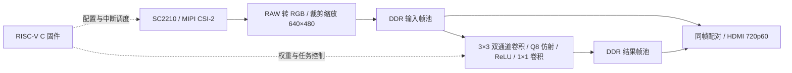

# FPGA 实时线稿：SC2210 + Ti60 + RISC-V

摄像头实时采集，FPGA 生成线稿，HDMI 左右显示同一完整构图的原画与处理结果。

本仓库正在整理为 2026 FPGA 竞赛作品资料。目前发布项目新增 RTL、RISC-V 固件主体和参数规格；**尚不是可以直接重建整板 bitstream 的完整发行包**。厂商 IP、基础参考工程和传感器寄存器表需另行核对再发布权限，详见 [依赖及发布范围](docs/DEPENDENCIES.md)。

## 系统结构



- 输入：SC2210，1920×1080 RAW；中心裁剪 1440×1080 后缩放至 640×480。
- 处理：双线性 Bayer 转 RGB、最近邻缩放、两层小型卷积结构；行缓存和 DDR 帧池。
- 输出：HDMI 1280×720，60 Hz 扫描；左右各一幅 640×480 完整图像。
- 控制：RISC-V 配置摄像头、下发 27 个系数、通过 PLIC 中断完成任务调度。
- 风格：手工设计的双极性拉普拉斯线稿；**不是训练得到的神经网络模型**。

## 目录

|目录|内容|
|---|---|
|`rtl/basic/`|项目新增的采集、缩放、帧管理、卷积、显示与诊断模块；含开发阶段诊断模块，并非全部同时例化|
|`firmware/`|RISC-V C/汇编/链接脚本；传感器配置表暂未公开，当前目录不能独立构建完整固件|
|`docs/style_spec.json`|实际权重、定点参数、边界处理与线稿算式|
|`docs/source_manifest.json`|本次公开源码与封存快照之间的逐文件 SHA256 对应|
|`docs/VALIDATION.md`|已记录的验收结果及证据边界|

## 已验收版本

2026-11-03 封存的上板 bitstream 为 2,744,055 字节：

```text
da410d2d0cd3d4001ca3edc78f62ea672082ec28b7c39fedd81a69f3d5f224d5
```

原构建报告 setup 最小 +0.295 ns，hold 最小 +0.018 ns。上述身份对应本地封存包；当前公开仓库尚未附 bitstream、完整工程及原始验收录像，不能仅凭此 README 代替这些证据。

## 当前限制

已测试 JTAG 加载及两次断电后重新 JTAG 加载。未完成 SPI 掉电自主启动验收。偏绿、在线调参、动态多风格等不作为当前完成项。

所用环境为 Windows、Efinity 2025.1.110.5.9、Ti60F225/C4、Efinity RISC-V IDE 2025.1；验证使用 Python、MinGW GCC、Icarus Verilog。完整复现说明随依赖范围核对后补齐。

报告、正式演示视频和照片目录仍在整理。参考示例视频不属于本作品，不收入本仓库。
